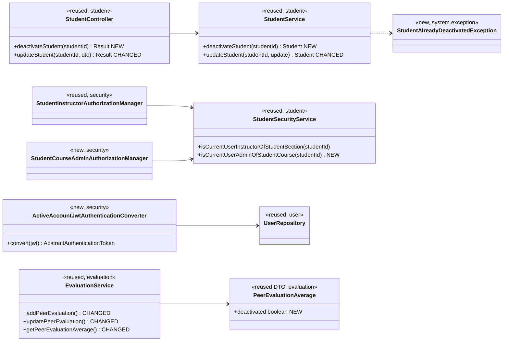

# Student (STU) Design

> Realizes: UC-STU-deactivate-student
> Depends on: FR-SEC-active-account, FR-SEC-authorization, FR-SEC-deny-unauthorized; BR-student-lifecycle, BR-section-scoped-access, BR-role-based-access, BR-submission-owed, BR-evaluatee-active, BR-evaluation-editable-until-close
> Touches: UC-EVA-submit-evaluation (step 2, extension 9a) and UC-EVA-section-evaluation-report (the deactivated marker), whose changes follow from BR-evaluatee-active and are built with this use case
> See: [use cases](../requirements/use-cases.md#uc-stu-deactivate-student-the-course-admininstructor-deactivates-a-student), [SRS security requirements](../requirements/software-requirements-specification.md#security-and-authorization-requirements), [architectural-design.md](architectural-design.md#shared-foundation-components) (shared foundation component view, [Crosscutting Concepts](architectural-design.md#crosscutting-concepts))
> Designed against `main` plus the firmed spec at `3268f5b` (2026-11-15).

## Overview

This area owns a student's account lifecycle inside the `student` foundation package. Deactivation turns off `PeerEvaluationUser.enabled` through a dedicated endpoint with its own authorization rule, and leaves the student in her course section and on her team (BR-student-lifecycle). Its effects reach three other places, each enforced where its rule lives: the security filter chain refuses a deactivated account on every request (FR-SEC-active-account); the `evaluation` service refuses a peer evaluation of a deactivated teammate (BR-evaluatee-active); and the `notification` slice already leaves her out of who owes what (BR-submission-owed), so reminders stop with no change there.

Before this design, deactivation was the Status dropdown in `EditStudentForm.vue` saving through `PUT /students/{id}`: no warning, no already-deactivated check, no path for the course admin who owns the course, and only the login checked `enabled`, so an open session lasted until its 2-hour token expired.

## Components & classes



**Backend**
- `student/StudentController.deactivateStudent` and `student/StudentService.deactivateStudent` (new). `StudentService.updateStudent` (changed) may re-enable but never disable (see *One path to deactivation*).
- `student/StudentSecurityService.isCurrentUserAdminOfStudentCourse` (new): compares `student.section.course.courseAdmin.id` with `UserUtils.getUserId()`, failing closed on an unknown id, as `SectionSecurityService.isSectionOwner` does.
- `security/authorizationmanagers/StudentCourseAdminAuthorizationManager` (new): same shape as `StudentInstructorAuthorizationManager`, reading the same `studentId` template variable with `PathVariables.readId`, so the route's `{studentId}` must keep that name.
- `security/ActiveAccountJwtAuthenticationConverter` (new): wraps the existing `jwtAuthenticationConverter()` bean in `SecurityConfiguration`, which wires it into `.oauth2ResourceServer(o -> o.jwt(j -> j.jwtAuthenticationConverter(...)))`.
- `security/SecurityConfiguration` (changed): the route rule in the API contract, placed before the `denyAll()` catch-all.
- `system/exception/StudentAlreadyDeactivatedException` (new), mapped in `ExceptionHandlerAdvice` to `409` / `StatusCode.CONFLICT`.
- `evaluation/EvaluationService` (changed): an evaluatee-active guard in `addPeerEvaluation` and `updatePeerEvaluation`, throwing the existing `PeerEvaluationIllegalArgumentException`; `getPeerEvaluationAverage` sets `PeerEvaluationAverage.deactivated`.
- Reused unchanged: `notification/SubmissionStatusService.findOwedItems`, which already filters `student.isEnabled()`.

**Frontend**
- `src/apis/student/index.ts`: `deactivateStudent(id)` on the shared `request` instance.
- `pages/students/EditStudentForm.vue`: for an active student, a "Deactivate student" button replaces the Status dropdown and opens `ElMessageBox.confirm` (step 4); for a deactivated student the dropdown stays, offering only re-enabling (see *Risks*). The dialog names the student and states each consequence in UC-STU-deactivate-student's Associated Information, one line each: she can no longer log in, and an open session ends on its next request; she stays on her team and her submitted weekly activity reports and peer evaluations are kept; she no longer owes either, nor is owed a peer evaluation, so she drops out of reminders; her teammates can no longer evaluate her; and she can be reactivated later, unlike deletion, which is permanent. Confirm and Cancel buttons; Cancel is 5a. On success, `ElMessage.success("<first name> <last name> has been deactivated.")` (step 6), the dialog closes, and `Students.vue` reloads its current page.
- `pages/students/Students.vue`: the Status tag reads "Active" / "Deactivated".
- `pages/evaluations/SubmitTeamsEvaluations.vue`: offers only teammates whose `enabled` is true (UC-EVA-submit-evaluation step 2). `GET /students/teams/{teamId}` already returns `enabled` on each `StudentDto` (`StudentToStudentDtoConverter`). The form's "every team member must be evaluated" is enforced in the form, over the rows it lists, so filtering the rows is what makes it "every active team member"; the server has no all-members check to change.
- `pages/evaluations/admin/SectionsEvaluations.vue`: a "Deactivated" `el-tag` beside the student's name when `row.deactivated` is true.

## Sequence

### UC-STU-deactivate-student: main flow, 5a, 6a, 6b

```mermaid
sequenceDiagram
    actor I as Course admin / instructor
    participant SPA as SPA (Students.vue, EditStudentForm)
    participant SEC as Security filter chain
    participant SC as StudentController
    participant SS as StudentService
    I->>SPA: Open the student (steps 1-2, UC-STU-view-student)
    I->>SPA: Deactivate student (step 3)
    SPA-->>I: Confirm dialog listing the consequences (step 4)
    alt cancel (5a)
        SPA-->>I: Dialog closes, no request
    else confirm (step 5)
        SPA->>SEC: PUT /api/v1/students/{studentId}/deactivate
        SEC->>SEC: active-account check, then anyOf(assigned instructor, owning course admin)
        alt neither (6b)
            SEC-->>SPA: 403 "No permission.", SPA routes to the forbidden page
        else allowed
            SEC->>SC: deactivateStudent(studentId)
            SC->>SS: deactivateStudent(studentId)
            alt already deactivated (6a)
                SS-->>SPA: 409 "This student is already deactivated." (toast, nothing changed)
            else active
                SS->>SS: enabled = false; team and course section untouched (BR-student-lifecycle)
                SS-->>SC: Student
                SC-->>SPA: 200 StudentDto (enabled false)
                SPA-->>I: "Student deactivated", list refreshed (step 6)
            end
        end
    end
```

### FR-SEC-active-account: a session already in progress

```mermaid
sequenceDiagram
    actor S as Deactivated student (token issued before deactivation)
    participant SPA as SPA
    participant F as BearerTokenAuthenticationFilter
    participant C as ActiveAccountJwtAuthenticationConverter
    participant U as UserRepository
    S->>SPA: any action
    SPA->>F: GET /api/v1/... (Bearer, not yet expired)
    F->>C: convert(jwt)
    C->>U: findById(userId claim)
    U-->>C: user with enabled false (or no user)
    C-->>F: throws DisabledException
    F-->>SPA: 401 "User account is abnormal." (ExceptionHandlerAdvice, AccountStatusException)
    SPA-->>S: token cleared, redirected to login (request.ts); logging in again fails with 401 (MyUserPrincipal.isEnabled)
```

UC-EVA-submit-evaluation 9a is one guard in `EvaluationService` (a `400` naming the deactivated teammate), so it has no diagram. `POST /evaluations` carries one evaluatee per request and the form sends one request per teammate, so a `400` for the deactivated one leaves the others saved, as 9a1 requires; the form's existing error toast shows her name.

## API contract

| Endpoint or job | Caller (who may) | Request | Success | Errors, by extension |
|---|---|---|---|---|
| `PUT /api/v1/students/{studentId}/deactivate` (new) | An instructor assigned to the student's course section, or the course admin who owns its course (BR-student-lifecycle, BR-section-scoped-access): `AuthorizationManagers.anyOf(studentInstructorAuthorizationManager, studentCourseAdminAuthorizationManager)` | Path `studentId`; no body | `200`, "Deactivate student successfully", the `StudentDto` with `enabled: false` | 6b, a student caller, or an unknown id: `403` with the `Result` envelope (the managers fail closed). 6a: `409` `CONFLICT`, "This student is already deactivated." 5a: no request is sent |
| `PUT /api/v1/students/{studentId}` (changed) | Unchanged (`userOwnershipAuthorizationManager`: an instructor assigned to her course section, or the student herself). `enabled` is applied only for a caller holding `ROLE_instructor`, as today, so a student never changes it | Unchanged | `200` with the stored student, so `enabled: false` on an active student comes back `true` (ignored); `enabled: true` on a deactivated student re-enables her | Unchanged |
| Every authenticated request (changed) | Bearer JWT | — | — | The account was deactivated, or no longer exists, since the token was issued: `401` (FR-SEC-active-account). Applies to deactivated instructors as well, as the FR says |
| `POST /api/v1/evaluations`, `PUT /api/v1/evaluations/{evaluationId}` (changed) | Unchanged | Unchanged | Unchanged | Evaluatee deactivated (UC-EVA-submit-evaluation 9a, BR-evaluatee-active): `400` `INVALID_ARGUMENT`, "<first name> <last name> is deactivated and can no longer be evaluated." |
| `GET /api/v1/evaluations/sections/{sectionId}/week/{week}` (changed) | Unchanged | Unchanged | Each `PeerEvaluationAverage` gains `deactivated` (boolean). The report already builds an entry for every student on a team, so a deactivated student with no evaluations that week is still listed, with empty scores. Its "who did not turn in" list comes from `GET /sections/{sectionId}/submission-status`, which already leaves her out (BR-submission-owed) | Unchanged |

## Key decisions

**A dedicated action endpoint.** `PUT /students/{studentId}/deactivate` carries its own authorization rule, its own 6a check, and no body. Rejected: reusing `PUT /students/{studentId}` with `enabled: false`, because that route also admits the student herself (`userOwnershipAuthorizationManager`) and a generic save cannot tell "deactivate" from "edit my name". Rejected: `DELETE`, which would blur deactivation with UC-STU-delete-student.

**One path to deactivation.** `updateStudent` ignores a change of `enabled` from true to false, so the only way to deactivate is the one with the warning and the checks (steps 4–6). It still applies false to true, keeping today's reactivation route until UC-STU-reactivate-student is built. Rejected: dropping `enabled` from the edit path, which would leave instructors no way to reactivate. Rejected: leaving the edit path unchanged, which bypasses steps 4 and 5.

**Already deactivated is a 409.** The request is well formed but conflicts with the student's state; `StatusCode.CONFLICT` exists for this, and the SPA's toast shows the message, which is 6a1's alert. Rejected: a silent `200`, which hides a stale page from the instructor; a `400`, which says the request itself was malformed.

**The account is re-checked on every request.** `ActiveAccountJwtAuthenticationConverter` loads the user named by the token's `userId` claim and throws `DisabledException` when the account is deactivated or gone; Spring's resource-server filter routes it through `CustomBearerTokenAuthenticationEntryPoint` to the existing `AccountStatusException` handler (`401`). This is what makes FR-SEC-active-account's "access to protected resources" true, not only its "authentication". The cost is one primary-key lookup per request at course scale (about 75 users). Rejected: a token denylist or a per-user token version, each needing a new table or column and a migration. Rejected: a shorter token lifetime, which narrows the window but does not close it.

**Authorization is two student-scoped managers composed with `anyOf`**, as NOT composes `sectionInstructor` with `sectionOwnership`. Rejected: `StudentInstructorAuthorizationManager` alone, which denies the course admin who owns the course but is not assigned to the course section, whom BR-section-scoped-access lets in (extension 6b names both). Both of the architecture's [enforcement points](architectural-design.md#crosscutting-concepts) are met by construction: the route names only the student, the managers load that student to check her course section, and the service then acts on the same `studentId`, so no second object can sit beside it in the URL. The route check runs before the service, so a caller outside her scope gets `403` even when she is already deactivated (6b before 6a). The SPA's global `403` handling (the forbidden page) is 6b1's alert.

**The evaluatee guard lives in `evaluation`; the form also filters.** The service guard is the requirement (9a, a stale tab, a hand-made request); the form filter is step 2's presentation. The guard covers `updatePeerEvaluation` as well, because re-submitting is submitting (BR-evaluation-editable-until-close). Rejected: filtering `GET /students/teams/{teamId}` on the server, because that endpoint has other readers and the rule is the evaluation slice's.

**The report marker is a flag, not a filter.** `PeerEvaluationAverage.deactivated` keeps the student listed with her evaluations, as UC-EVA-section-evaluation-report's parameters require. Rejected: omitting her, which would hide evaluations already on record (BR-evaluatee-active).

## Data model

No delta. `PeerEvaluationUser.enabled` already exists, and deactivation changes nothing else: `Student.section` and `Student.team` stay as they were (BR-student-lifecycle). The entities are as the SRS's [Business Domain Model](../requirements/software-requirements-specification.md#business-domain-model) defines them.

## Reuse & cross-cutting

- Authorization: the `AuthorizationManager` family, `PathVariables.readId`, `UserUtils.getUserId`.
- Errors: the `Result` envelope through `ExceptionHandlerAdvice`; the existing `AccountStatusException` (`401`) and `AccessDeniedException` (`403`) handlers.
- Reminders and "has not submitted": `SubmissionStatusService`, unchanged; its deactivated-student coverage is the *BR-submission-owed recipients* row in [not.md](not.md#tests).
- SPA errors: `request.ts` already turns a `401` into a logout and redirect, a `403` into the forbidden page, and anything else into a toast, so the dialog handles no status code itself.

## Tests

| Use case, flow | Level | Asserts |
|---|---|---|
| UC-STU main, assigned instructor | integration | `PUT …/deactivate` returns `200` with `enabled: false`; the student's team and course section are unchanged |
| UC-STU main, owning course admin | integration | A course admin who owns the course but is not assigned to the course section gets `200` |
| UC-STU main, service | unit | `deactivateStudent` sets `enabled` to false and saves, and leaves `team` and `section` unchanged |
| UC-STU step 4 | E2E (Cypress, API stubbed) | Before any request is sent, the confirm dialog names the student and shows each consequence listed under *Frontend* (login and open session, team and work kept, nothing owed, teammates can't evaluate her, reactivation versus deletion) |
| UC-STU 5a | E2E (Cypress, API stubbed) | Cancelling the confirm dialog sends no `PUT` |
| UC-STU step 6 and 6a, in the SPA | E2E (Cypress, API stubbed) | A `200` shows the success message, closes the dialog, and reloads the list with the student tagged "Deactivated"; a `409` shows the already-deactivated message as a toast |
| UC-STU 6a | unit and integration | An already deactivated student: the service throws `StudentAlreadyDeactivatedException`; the endpoint returns `409` with the message; she stays deactivated |
| UC-STU 6b | integration | An instructor not assigned to the course section, a course admin of another course, the student herself, and any caller naming an unknown student id each get `403` with the `Result` envelope; the student stays active |
| UC-STU session in progress (FR-SEC-active-account) | integration | A token issued before deactivation gets `401` on its next request; logging in again with valid credentials gets `401`; the same holds for a deactivated instructor's token |
| UC-STU consequence, owed and reminders | existing | `SubmissionStatusServiceIntegrationTest`'s deactivated-student cases (she owes nothing, and a teammate who evaluated every active teammate but not her owes nothing) are cited, not rewritten |
| UC-STU edit path | integration | An assigned instructor's `PUT /students/{studentId}` with `enabled: false` returns `enabled: true` and leaves the student active; with `enabled: true` it re-enables a deactivated student; the student's own `PUT` never changes `enabled` |
| UC-EVA-submit-evaluation step 2 | E2E (Cypress, API stubbed) | The peer evaluation form lists only teammates whose `enabled` is true |
| UC-EVA-submit-evaluation 9a | unit and integration | `addPeerEvaluation` and `updatePeerEvaluation` of a deactivated evaluatee return `400` naming her; the evaluator's evaluations of other teammates are saved |
| UC-EVA-section-evaluation-report, deactivated | integration | The report lists the deactivated student with `deactivated: true` and the evaluations of her submitted that week; for a week with none, she is still listed with empty scores |

## Open questions / risks

- **TD-student-reactivation-stopgap.** Re-enabling through the edit dialog's Status dropdown has no confirmation and no already-active check; it is UC-STU-reactivate-student's job and is kept only so instructors are not left without a way back. Retire it when that use case is built.
- **Instructors are covered too.** The per-request check ends a deactivated instructor's open session as well. That is what FR-SEC-active-account says, but it changes behavior for UC-INS-deactivate-instructor, which has no tests yet.
- **A course admin not assigned to the course section cannot reach step 2 from the SPA.** The API admits her to `PUT …/deactivate`, but UC-STU-view-student's routes (`GET /students/{studentId}` through `userOwnershipAuthorizationManager`, and the course-section-scoped search) admit only an assigned instructor, so she cannot open the student's dialog. Widening those routes is UC-STU-view-student's change, not this one's (follow-up issue #3). In the `dev` seed data every course admin is also assigned to each course section of her courses, so the seeded main flow is unaffected; the *owning course admin* integration test first removes the course admin from the student's course section, then calls the API directly.
- **`403` for an unknown student id**, not `404`, because the managers fail closed and do not reveal which ids exist. Accepted, as for the other student routes.
- **Architecture-of-record updated.** [Crosscutting Concepts](architectural-design.md#crosscutting-concepts) (Tokens, Known gaps) now states the per-request active-account check, marked designed and not yet built; `/implement` drops that marker when the check ships.
